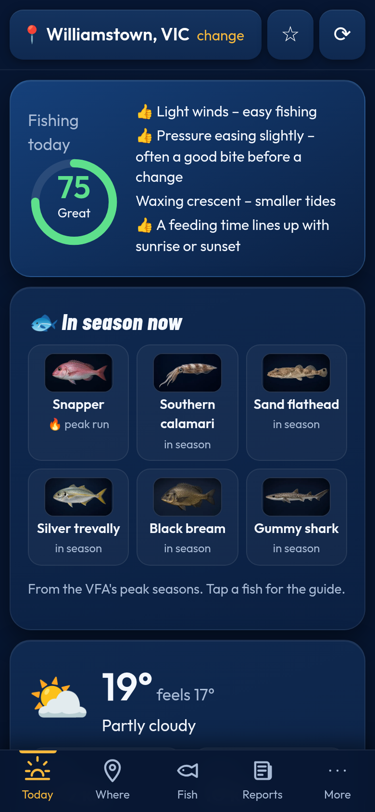
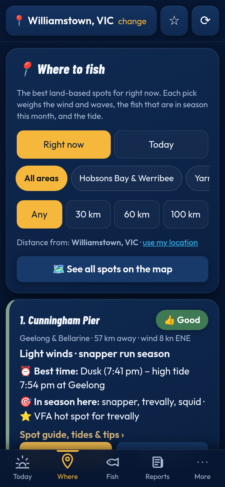
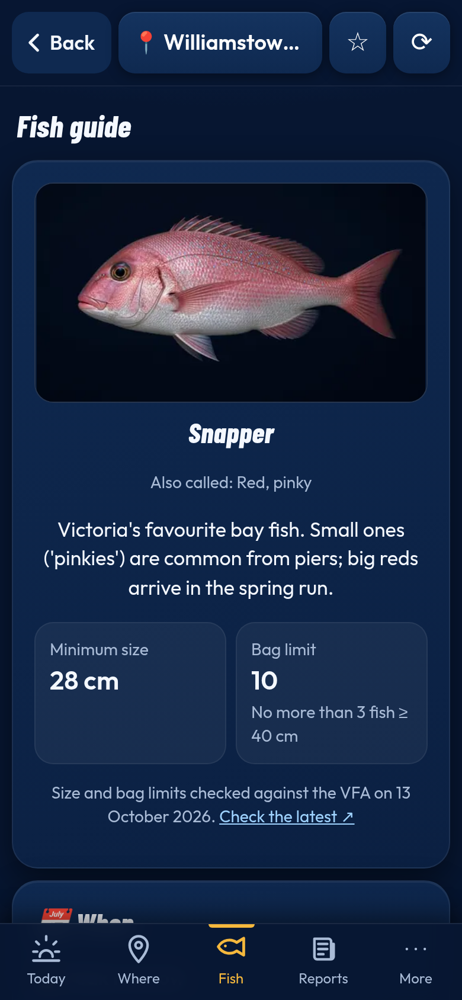
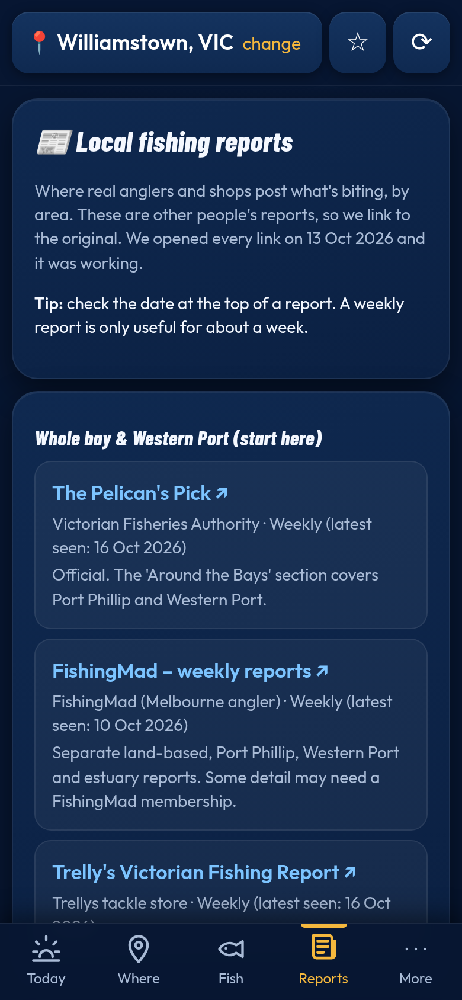

# Choc's Spot – land-based fishing for Victoria

**Live app:** https://nicco385.github.io/Ripcast-/ (open it in a phone browser and use *Add to Home screen*)

Choc's Spot shows land-based anglers around Port Phillip Bay and Victoria where to fish today and when. It ranks piers, beaches and rocks using live wind, waves, tide and season data.

| Today & tides | Where to fish | Fish guide | Reports |
|---|---|---|---|
|  |  |  |  |

## Features
- **Today:** fishing score out of 100 with reasons, live weather, wind and gusts in knots, pressure trend, waves, swell, sea temperature, the fish in season now, solunar feeding times, sunrise and sunset, a 24-hour strip, and **official tide times** with a tide chart
- **Tides:** the Bureau of Meteorology's own predictions for 20 Victorian stations (Williamstown, St Kilda, Geelong, Queenscliff, Mornington, Flinders, Stony Point, Tooradin, Cowes, San Remo and more), stored in the app so they work offline. 7-day view for any station. Times match the BOM tables exactly. Tables run from Oct 2026 to 31 Dec 2027.
- **Where to fish:** the best land-based spots for the wind, waves, fish in season and tide, by area and distance. Each spot has a guide (fish, access, tips, tides, closures)
- **Fish guides:** 19 species, including the freshwater perch (estuary, golden, silver) and redfin for the city rivers and Albert Park Lake; with where to fish from the shore, season, best time and tide, rig, tackle, hooks, baits, lures, tips, handling and the VFA size and bag limit
- **What's biting:** a month-by-month calendar of fish movements for Port Phillip and Western Port
- **Reports:** curated, working links to current local reports, by area
- **Map:** the land-based spots plus marine sanctuaries (no-fishing zones); tap anywhere to check conditions there
- **Catches:** a catch log that warns when a fish is under the legal size (stored on the device only)
- **Back button works:** the Android back gesture and browser Back step through tabs, guides, the map and the spot picker
- Installable PWA that works offline with the last saved data, and safety warnings for wind, storms and swell

## Tech
Vite, React 18 and TypeScript, with no UI framework and hand-written CSS. The Leaflet map is code-split into its own chunk and only loads when the Map tab opens. The service worker (`public/sw.js`) caches the app shell. Images are WebP: the hero is about 52 KB and each species tile is about 6 KB, lazy-loaded. Deployed to GitHub Pages.

```bash
npm install
npm run dev                                  # local
GH_PAGES=1 npx vite build --outDir dist-pages  # Pages build
```
To rename the app, edit `APP_NAME` in `src/config.ts`. The cover, title and manifest all update.

## Credits
- Tide times and heights: Bureau of Meteorology tide predictions, © Commonwealth of Australia. Based on Bureau of Meteorology information that has subsequently been modified (reformatted into this app). Predictions are a guide only.
- Weather & marine data: [Open-Meteo.com](https://open-meteo.com/) (CC BY 4.0)
- Map data and marine park / sanctuary outlines © [OpenStreetMap](https://www.openstreetmap.org/copyright) contributors (ODbL), via Leaflet
- Fonts: Barlow Condensed and Outfit (SIL Open Font License), bundled with the app
- Rules summary: Victorian Fisheries Authority, checked 13 October 2026. Always check the official guide.
- Fish seasons, spot details and tips: VFA Go Fishing pages (Port Phillip Bay, Western Port) and The Pelican's Pick; fish movements from FishingMad weekly reports, Peninsula Insider and Compleat Angler Dandenong (see the in-app sources).

*Scores and tides are a guide only. Check BOM warnings and VFA rules, and fish safely.*

- Tide dial (rising/falling + countdown), day tide graph with sunrise/sunset, moonrise/moonset, and solunar feeding times (traditional theory, guide only) – v1.2.0
- Target a fish (v1.3.0): pick a species and the app ranks the best land-based spots for the next 24 hours from forecast wind/waves, BOM tides, time of day, moon and season, with plain-English verdicts, best times and a quick rig tip. "Tonight's best targets" on Today. Scenario checks: `npm run test:target`.
- v1.4.0: one rating engine (src/target.ts) now drives Fishing today, Where, Target a fish and the 7-day forecast, so they always agree; rain/showers are weighted properly (a showery day is capped at Fair). Shorter Today screen, one "best time" per screen, "last checked" warnings on hand-entered closures/limits/reports and near the end of the tide tables, catch log with spot, photo (stored on the phone), edit/delete, auto-saved conditions and backup/restore, a Facilities card on every spot (src/data/facilities.ts – only checked facts, otherwise "Not known"), "Bait & tackle near here", an add-to-home-screen prompt, and snook/kingfish/Murray cod moved under "More fish".
- v1.4.1: accuracy audit. Every species at every spot checked against the VFA regional "where to fish" pages, VFA Go Fishing lists, FishingMad and Bite Compass spot guides, and local reports (src/data/audit.ts lists the changes and the reason for each). Fish that are only an odd catch at a spot are labelled "(occasional)" and can never be a top pick (capped at Fair). Kerferd Road, St Kilda, Hampton, Seaford, Safety Beach and St Helens squid are now "occasional". Season edges are softened (the month either side of the VFA season is a "shoulder", not "out of season"). Light-line fish at a sheltered pier in a 20–24 kn blow are Fair, not Poor. Night bonus is bigger only where pier lights are confirmed. All VFA bag/size limits re-checked, Sorrento and Ferguson Street pier map pins fixed, calendar/snook/squid guides tightened. Scenario printer: tests/scenarios.ts.
- v1.4.2: mulloway guide rebuilt from the VFA-funded Victorian Mulloway Tagging program (Nature Glenelg Trust), Arthur Rylah Institute tracking and FishingMad: soft autumn–winter season (Mar–Aug best, possible all year), Melbourne movements (Patterson ↔ Yarra ↔ Maribyrnong), after-rain/flow advice, how to report a tagged fish (mullowaytag@ngt.org.au), and the VFA's proposed 70 cm / bag 2 rule change flagged as a proposal only.
- v1.4.3: tips from three Victorian experts Choc recommends, each credited by name with the video/article title and date: Brendan Wing (YouFishTV – Western Port mulloway and snapper), Lee Rayner (Fishing Edge videos; Fishing Monthly garfish article) and Brett Reed (Reedy's Rigs – snapper, whiting and gummy rigs). Snapper, whiting, squid, gummy, garfish and mulloway guides updated; boat-only advice is labelled. New spot: Corinella Pier (Western Port, VFA). Their channels and site added to Reports as 'Learn' links.
- v1.4.4: Lee Rayner land-based tips from the Australian Lure Fishing Podcast show notes (Ep 513, May 2022; Ep 276, Oct 2020): winter squid Frankston–Sorrento, Mordialloc reef side, low-tide change, 3.0–3.5 jigs, float-suspended jig from land; land-based snapper in a big blow with low barometer; bigger snapper shallow before dawn.
- v1.4.5: Altona Pier squid downgraded to 'occasional' (VFA habitat wording only, pre-new-pier; almost no real catch reports – one disputed 2005 forum claim, a 2019 'No squid' reply, none since the new pier opened Dec 2023). Occasional-catch spots now always rank below regular spots, so they never top Target-a-fish.
- v1.4.6: map taps get a friendly name (suburb via OpenStreetMap, or the nearest app spot offline – never raw coordinates; old 'Map spot -37…' names are renamed). Today/7-day picks are limited to spots within about 25 km by road (Bellarine ↔ elsewhere counts double, across the Heads ×6), with a warning when nothing is near and distances shown. Target a fish defaults to 'Nearby (25 km)' so it matches Today. Badges never wrap.
- v1.4.7: Spot first. When you pick a known spot, Today and Target talk about that spot (its own fish, best time, why, rig), with nearby spots only shown when they are clearly better. No more double brackets ("Pier, Williamstown · 4 km"); the "change" link in the header is never cut off.
- v1.4.8: Local-angler spots. Added Webb Dock rock wall (Port Melbourne rocks), Hampton rock groynes, Williamstown seawall rocks (already there; now rated), Sandringham breakwater, Princes Pier, Lagoon Pier, Black Rock Jetty and Beaumaris Pier, each with sources, hazards and Not-known where unverified. Fixed the Hampton Pier pin (it was inland). Local-favourite and "quieter than listed" snapper adjustments, rock-ground night warning, wider per-spot wind shelter.
- v1.4.9: Choc's first personal spot: Black Rock Beach – Choc's spot (squid and garfish, proven, from Choc's own fishing). Checked outside Ricketts Point Marine Sanctuary (about 390 m north-west of its Fourth Street boundary), with a stay-outside notice, Not-known facilities where unverified, an orange map marker, and a +3 'Choc's spot' boost.
- v1.5.0: Choc's second spot: North Road rocks, Brighton – Choc's spot (squid and garfish, proven). The rock wall about 120 m south of the North Road boat ramp, about 920 m north of Middle Brighton Pier, so it's a separate spot. Not in any marine park. Boat ramp, marina and hazard notes; Not known where unverified.
- v1.5.1: North Road rocks typed as rocks (big-wave stay-off rule and the after-dark headlamp warning now apply).
- v1.5.2: Choc's third spot: Williamstown Beach east rock wall – Choc's spot (squid, proven). About 1.1 km west of Point Gellibrand, about 900 m east of Jawbone Marine Sanctuary; swimmer-zone and sanctuary notice, Not known where unverified.
- v1.5.3: Choc's lower-Yarra spots: Yarra bank by the power tower, Spotswood (snapper, gummy shark) and Francis Street lookout, Yarraville (snapper, mulloway, bream) – all proven as Choc's knowledge, river type with Lower Yarra eating advice, port/shipping and power-line notices, Not known where unverified.
- v1.5.4: Choc's Lynchs Bridge spot (Maribyrnong River): bream, pinkies and estuary perch proven, mullet listed. Riverside platform about 150 m downstream of the bridge on the Flemington bank; estuary perch rules (VFA), Parks Victoria river rules, Lower Maribyrnong eating advice.
- v1.5.5: Choc's Chifley Drive spot (Maribyrnong): bream and estuary perch proven, at the Dale Street end of Parks Victoria's Chicago St–Dale St fishing platforms; Defence-site fence warning. (v1.5.4 and v1.5.5 deployed together.)
- v1.5.6: Choc's Bolte Bridge spot (Moonee Ponds Creek mouth, Docklands bank): bream, snapper/pinkies and mulloway proven; public access not confirmed (trail closed since 2020), power-line and shipping warnings.
- v1.5.7: Choc's River Esplanade pier spot (Yarra's Edge, south bank): bream, snapper/pinkies and mulloway proven; kept separate from the Bolte Bridge spot across the river. City of Melbourne Docklands fishing source added to both.
- v1.5.8: Choc's Punt Road Landing spot (Yarra, South Yarra): bream and mulloway proven; Parks Victoria lists fishing permitted; rowing/boat-traffic notice and Lower Yarra eating advice.
- v1.5.9: Albert Park Lake becomes Choc's spot (Carousel shore, Aughtie Drive): trout, golden perch, estuary perch, silver perch and carp proven; new species rainbow trout and European carp (VFA rules, carp never returned alive); lake fish now rated (no tides). Hampton rock groynes become Choc's spot: pin moved to the southern (Orlando Street) groyne; flathead, snapper/pinkies, garfish and whiting proven.
- v1.5.10: Freshwater Choc spots show the 'Choc's spot – local knowledge' note (Albert Park Lake).
- v1.5.11: Access notes from Choc – Bolte Bridge spot from the very end of Docklands Drive (track still not confirmed public), River Esplanade pier from the Lorimer St side. Hampton: Choc's southern groyne kept; notes say it is not the Orlando Street groyne (that one is about 700 m north).
- v1.5.12: New spot – Orlando Street groyne, Hampton (normal researched spot, not a Choc's spot): pinkies proven from forum reports, squid occasional.
- v1.6.0: New 'Tips & rigs' page (More tab and Fish tab): shore-fishing tips from Roger Osborne Fishing (planning, reading a beach, finding fish, rigs, baits, flathead), paraphrased, each linked to its video; matching tips shown on the whiting, bream, flathead, salmon, snapper and mulloway guides.
- v1.7.0: Tips & rigs now merges tips from Lee Rayner, Brett Reed (Reedy's Rigs), Brendan Wing (YouFishTV) and Roger Osborne by topic (plan, Victorian spots, beach, finding fish, rigs, baits, hooking, lures), with shared credits and per-tip source links; fish guides show extra expert tips not already in the guide.
